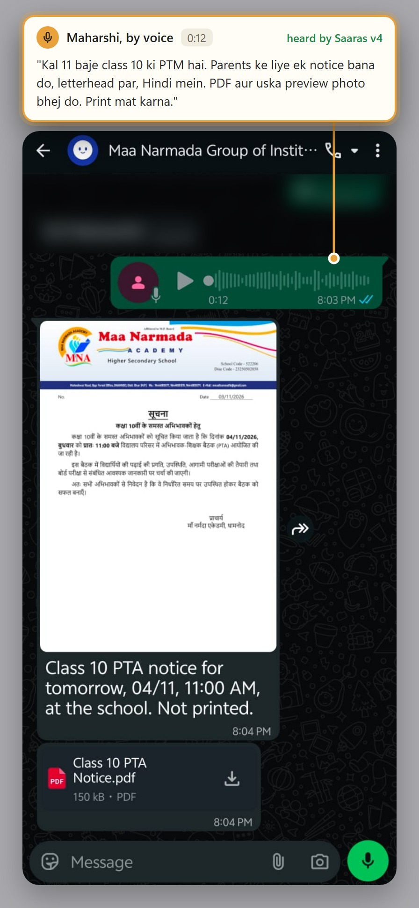
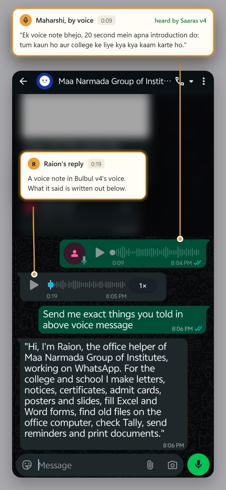
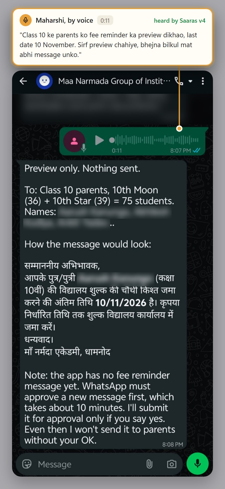
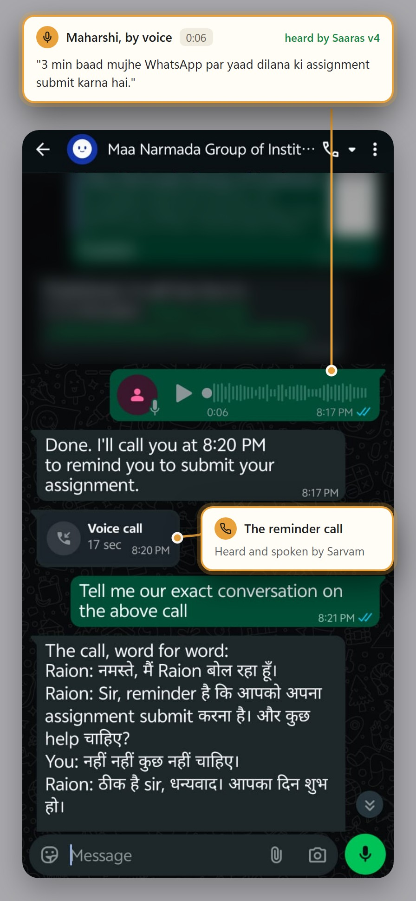
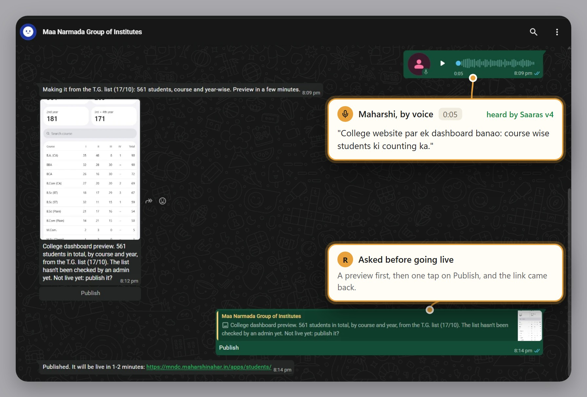
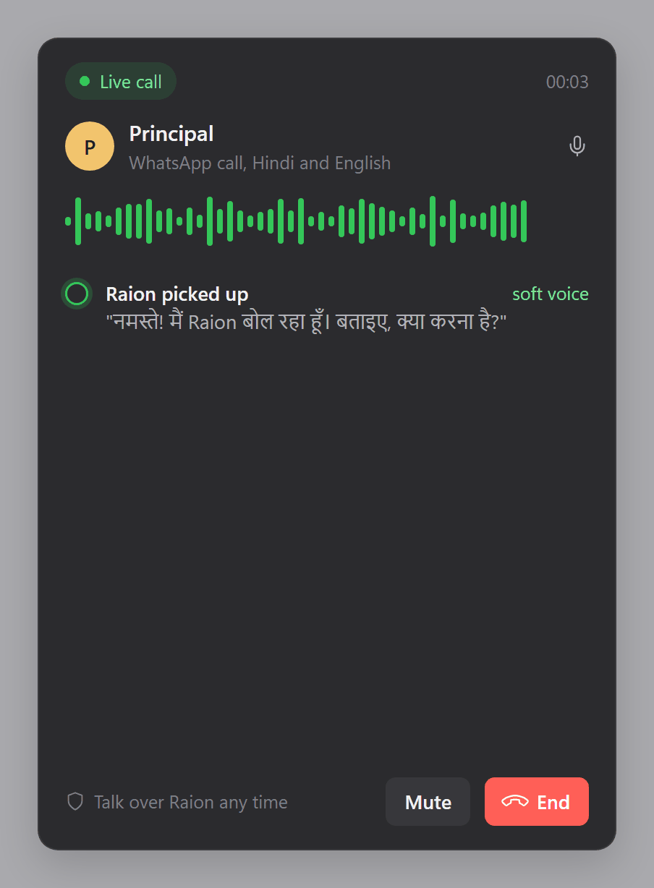
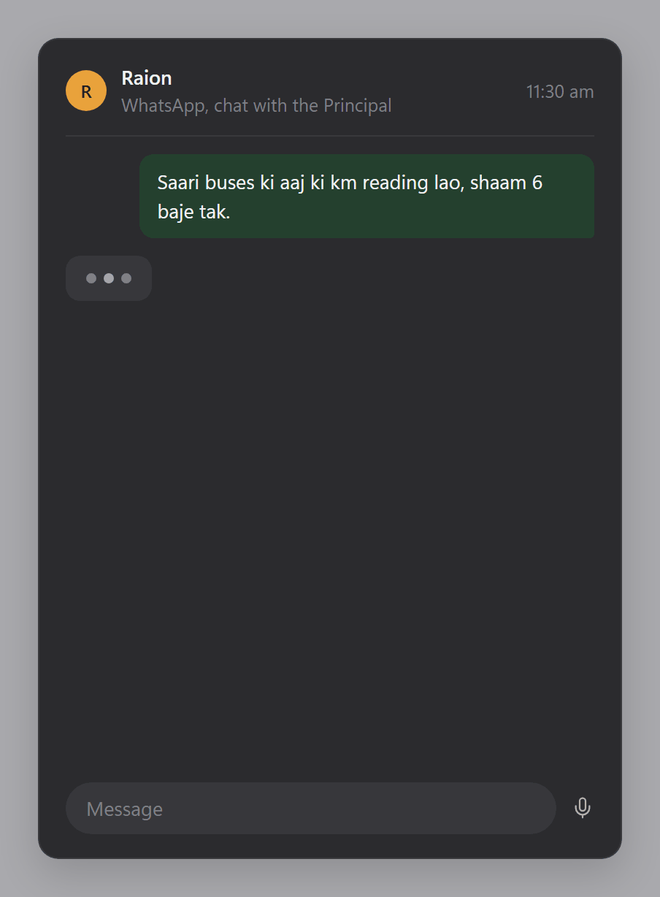
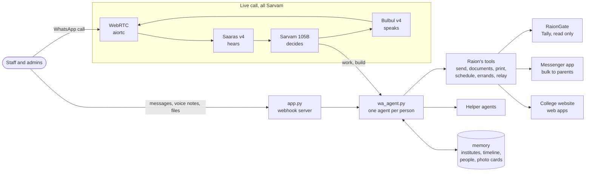

<div align="center">

# Raion

**An AI that runs the office of a group of Indian institutes, on WhatsApp, in Hindi.**

Staff message it or call it. It writes the letters, fills the registers, reminds, chases people,<br>
reads the accounts, messages parents and builds small web apps. Its ears, voice and call brain are Sarvam.

Real chats with Raion on WhatsApp, 3 November 2026. Every request was a voice note; the boxes say what was in it.<br>
Older messages and students' names are blurred.

| | |
|:-:|:-:|
| <br><sub>A PTM notice on the school's own letterhead, in Hindi</sub> | <br><sub>Raion introduces itself in a voice note</sub> |
| <br><sub>A fee reminder for 75 parents: shown, not sent</sub> | <br><sub>A reminder that came as a phone call, word for word</sub> |


<p align="center"><sub>A 5-second voice note, a dashboard of 561 students by course and year, live on the college website after one tap</sub></p>

</div>

## Why it exists

In a small-town college office, three or four people do everything: notices, fee lists, certificates, calling
parents, chasing bus drivers for readings, answering the principal at 10 at night. They work in Hindi, on their
phones, on WhatsApp. Software built for big city schools (ERPs, portals, one more app to install) never fits them.

Raion goes the other way. It lives where they already are, speaks the way they speak (Hinglish, by voice), and does
the work itself instead of handing them another form to fill.

It is built for, and used at, **Maa Narmada Group of Institutes** in Dhamnod, Madhya Pradesh: a degree college
(MNDC), a B.Ed college (MNCE), a school (MNA) and an ITI.

## A call, start to finish



The principal calls Raion on WhatsApp and asks, in Hinglish, for a fees dashboard. The drawing on the right shows
each step; the real reminder call is in the screenshots at the top.

1. **Saaras v4** hears it live, Hindi and English mixed in one sentence.
2. **Sarvam 105B** decides what to do, in about half a second.
3. **Bulbul v4** answers in a soft Hindi voice.
4. Raion's builder agent makes the dashboard, tests it, puts it on the college website and sends the link on
   WhatsApp, a few minutes later.

The caller can talk over Raion at any time, like with a person. When the call ends, Raion's WhatsApp side gets a
summary, so nothing said on the phone is lost.

<br clear="right">


## Sarvam inside

| Where | Sarvam model | What it does |
|---|---|---|
| Call: ears | `saaras:v4`, streaming speech-to-text over WebSocket | Hears Hindi, English and Hinglish live (`codemix`). Its voice-activity signals let the caller cut Raion off mid-sentence. |
| Call: brain | `sarvam-105b-conversations` | Every turn returns JSON: what to say, and what to do (hand work to WhatsApp, build a web app, edit the letter on the office screen, hang up). Thinking off, JSON mode. 0.3 to 1.2 s a turn in our tests, against about 2 s before. |
| Call: voice | `bulbul:v4-flash`, streaming text-to-speech | Speaks back at 24 kHz in a soft, warm voice (`ratan_hi_latenight_warm`). Audio streams back as it is made. |
| WhatsApp voice notes | `saaras:v4` and `bulbul:v4-flash` | Voice notes are understood like text. Ask for a voice reply and Raion answers with a voice note. |

**Why Sarvam.** Our staff mix Hindi and English in every sentence ("fees ka dashboard bana do, course wise"), and
Saaras takes that as it comes. Bulbul sounds like someone from the office, not a foreign assistant. One provider
for ears, brain and voice keeps a call quick, and the office dashboard shows what each call cost, in rupees.

## What it does

### Talk to it on WhatsApp
- Text, voice notes, photos, PDFs, Word and Excel. Files sent one by one wait in a tray and are read together with
  the next message.
- Replies with files, quick-reply buttons and lists, or a voice note when asked.
- Send more while it works: new messages reach it mid-task. Ask it to stop and it stops.
- Every person has their own folder, memory and session. Admins and staff get different powers; unknown numbers are
  ignored.
- WhatsApp closes free messaging after 24 hours of silence. Raion then sends one approved "update waiting" message,
  and the update goes out the moment they reply.

### Phone calls
- Call Raion on WhatsApp, or let Raion call you: "kal subah 10 baje phone karke yaad dilana" becomes a real call at
  10. Missed it? It comes as a message.
- Dictate a letter on the call. It appears on the office computer's screen as an A4 page and changes as you speak:
  "doosri line hata do", "mitron ko saathiyon karo".
- Ask for real work on the call. It goes to the WhatsApp agent, which sends the result in the chat. Admins can ask
  for a web app and get the live link.

### Documents, the office's way
- Letters, notices and certificates on the institute's letterhead, in formal Hindi, as PDF.
- Fills the office's own Word and Excel files, so they look exactly like theirs.
- Slides, Word and Excel from scratch; posters and WhatsApp cards as images; reels and event videos.
- A whole class at once: 46 admit cards from the student list, in one PDF to print.
- Looks at a preview of every page before sending (overflow, broken Hindi, blanks left over) and rebuilds if
  something is off. Every version is kept.
- Prints on the office printer after a yes. On letterhead paper it leaves out the parts already printed.

### Memory that stays correct
- Knows the institutes: a fact file for each (people, posts, timings, fees, processes), a catalog of every document
  the office makes, its formats, and the student, staff and bus lists. Every Word, Excel and PDF has a text copy it
  can search.
- A shared timeline of events, meetings, exams, holidays and documents issued, written by everyone's chats.
- Each person's own memory: preferences, standing rules, pending work. Admins also get private memory for money,
  staff matters and personal errands.
- A memory keeper runs after each chat and keeps only what will matter later. When two people give different
  dates, it keeps both and marks the clash instead of overwriting one.
- Teach it once and everyone knows. Corrections from staff wait for an admin's okay, and Raion asks a few open
  doubts at a good moment.
- Every night from 1 to 2 AM: backup, tidy, old events archived, and a log of what changed.

### Photo memory
- Every photo gets a text card within minutes: what it shows, the date, the text in it, keywords in Hindi and
  English. A small model reads 12 photos at once from one contact sheet, so it stays cheap.
- "pichle saal ki annual function ki newspaper cutting" finds the cutting.
- Lasting photos (events, press, certificates) go into the institute's record, by year and event.

### Automations
- "Roz raat 11 baje education ki khabrein bhej dena": tasks that run on their own and send the result.
- Watches websites (university notices, results) and sends only what is new.
- Makes files on a schedule: the fee defaulters sheet on the 1st of every month, in the office's own Excel.
- Reminders as a message or as a phone call.
- Sets a follow-up by itself only when something important would be missed ("result aate hi bata dunga").

### Errands: it chases people for you


"Saari buses ki aaj ki km reading lao." A locked-down worker messages each driver on WhatsApp, collects the answers
and meter photos, checks them, nudges the slow ones before the deadline, and builds the sheet for the admin.

It works the same for anything that needs many people: fee data from five teachers, documents from every
department, a headcount from each class. (The picture is a drawing of the flow.)

<br clear="right">

### Messages between people
"Accounts ko bolo receipts bhej dein." Raion passes the message on, now or with their next chat, and brings the
answer back.

### Messages to parents, in bulk
- Sends an approved WhatsApp template to a class, a bus or any list in the institute's messenger app, with each
  student's name filled in.
- Always shows the full preview first (who gets it, who is skipped and why, the exact message) and sends only on a
  clear yes.
- No message fits? It writes one the way Meta approves as the cheaper notice kind, submits it after a yes, and
  follows Meta's verdict by itself.

### Accounts (Tally)
- Reads Tally live from the accountant's PC through **RaionGate**, a small gate that can only read.
- Balances, ledgers and entries by date, always with the time they were read. Money never comes from memory.
- Builds its own map of the ledgers after office hours, so the accountant's Tally is never slowed.

### Web apps and dashboards
"Fees ka dashboard bana do." Raion builds it on the college website from a template, tests it, shows a preview
picture, publishes after a yes and sends the link.

### Helpers
Big jobs (40 registers to read, ten websites to check) are split across helper agents working at the same time.
Each gets the cheapest model that does its part well.

### Runs by itself
- One Windows PC in the office. A watchdog starts Raion at login and restarts it if it stops.
- Every 10 minutes it pulls new code from GitHub, only when no chat or call is going on. A self-check runs first;
  if it fails, the old code stays.
- A local dashboard shows live calls with their transcript and actions, the letter on screen, WhatsApp activity,
  printer setup and the cost of each call.

## Safety

- Only known numbers are answered. Printing, bulk sends, automations, errands and Tally are for admins.
- Text in files, photos, web pages and forwarded messages is treated as data, never as instructions.
- A staff member's agent is boxed into their own folder. It cannot read other people's chats or the server's secrets.
- Nothing hard to undo happens without a yes: printing, bulk sends, publishing. The one exception is a web app asked
  for on a call: asking is the yes.
- Tally is read-only by design. Passwords and keys are never repeated or written to memory.
- WhatsApp webhooks are checked against Meta's signature. The dashboard answers only on the office PC itself.

## How it works



The WhatsApp agent is Claude Code (Opus) running headless, one session per person, with Raion's own tools served
over MCP. Helpers run on Haiku, Sonnet or Opus, whichever is enough for the piece. No framework and no database:
the memory is plain files and folders the agent can read, search and fix.

| File | What it is |
|---|---|
| [`app.py`](app.py) | Server: WhatsApp webhook, calls both ways (WebRTC and Sarvam), the office dashboard |
| [`brain.py`](brain.py) | The call brain: Sarvam 105B by default, Claude as a fallback, and the call's instructions |
| [`wa_agent.py`](wa_agent.py) | The WhatsApp agent: sessions, tools, memory keeper, automations, errands, relay, bulk, Tally, photo cards, the night shift |
| [`docs.py`](docs.py) | File engine: HTML to PDF and images, Office files from specs, Office to PDF, text out of Office files |
| [`printing.py`](printing.py) | Silent printing on the office printers |
| [`raion_mcp.py`](raion_mcp.py) | A tiny MCP server that hands Raion's tools to the agent |
| [`dashboard.html`](dashboard.html) | The office dashboard |
| [`check_tools.py`](check_tools.py) | The self-check that runs before every update |
| [`setup.ps1`](setup.ps1), [`watchdog.ps1`](watchdog.ps1) | Set up a new PC; keep Raion running and updated |
| [`RaionGate/`](RaionGate) | The read-only Tally gate for the accountant's PC |
| [`docs/`](docs) | The GIFs here: [`gifs.html`](docs/gifs.html) holds their frames, [`render.py`](docs/render.py) makes them |

About 6,500 lines of Python.

## Where this goes

Today Raion runs one group's office. The goal is an institute where every routine job is done by AI agents, and
the people spend their time on students.

**Next**

- **Every PC, learning every night.** A small agent on each office computer records which apps and files were used
  and what was typed (never passwords), and sends text, not video. Every night Raion reads the day's work, spots
  what people keep repeating, and turns it into a new skill, so the next day it can do that job itself. Admins get a
  plain report of where the time went.
- **A kiosk at reception.** A screen and a mic in the office. Parents and visitors ask out loud, in Hindi, and
  Raion answers in Sarvam's voice: admissions, fees, timings, where to go.
- **Parents ask about their own child.** Once Raion is sure it is the parent: attendance, fees due, marks, the bus.
  On the kiosk or on WhatsApp, at any hour.
- **Grievance redressal.** Any complaint, from a parent, a student or anyone, by voice or text, gets a number, goes
  to the right person, is chased until it is closed, and the person is told what was done.
- **Biometric attendance.** Read the biometric machines: late and absent alerts to parents, staff attendance to the
  admins.
- **Bus GPS.** Agents watch every bus: "the bus is 10 minutes away" to parents, delays and overspeeding to the
  transport in-charge.
- **More Sarvam.** Sarvam Vision to read old handwritten registers and scanned forms; Saaras keyterms for local
  names (Nahar, Dhamnod, MNDC); document translation between Hindi and English.

**Then**

Package Raion so any school or college in a tier 2 or tier 3 town can run its office on one PC and WhatsApp, in its
own language. Our four institutes first, then the institutes around us.

## Run it

You need a Windows PC, Python 3.12, Claude Code signed in, a Sarvam API key, a WhatsApp Cloud API number and an
HTTPS tunnel (we use ngrok).

```powershell
powershell -ExecutionPolicy Bypass -File setup.ps1          # installs what's missing, makes .venv
.venv\Scripts\python.exe check_tools.py                      # must print ok
powershell -ExecutionPolicy Bypass -File setup.ps1 -Start    # starts Raion and the watchdog
```

`.env` holds `WA_TOKEN`, `WA_PHONE_NUMBER_ID`, `WA_VERIFY_TOKEN`, `WA_APP_SECRET`, `SARVAM_API_KEY`,
`ADMIN_NUMBERS` and `ALLOWED_NUMBERS`. Optional: `CALL_MODEL` (set `haiku` to put calls back on Claude),
`SARVAM_CALL_SPEAKER`, `SARVAM_CALL_PACE`. The institutes' knowledge lives in `memory/` on the office PC and is not
in this repo. Full steps: [SETUP.md](SETUP.md).

## Who builds it

**Maharshi Nahar**, third-year student at IIIT Pune. Raion started as help for my family's institutes in Dhamnod
and is turning into a startup: AI-run educational institutes for small-town India.
